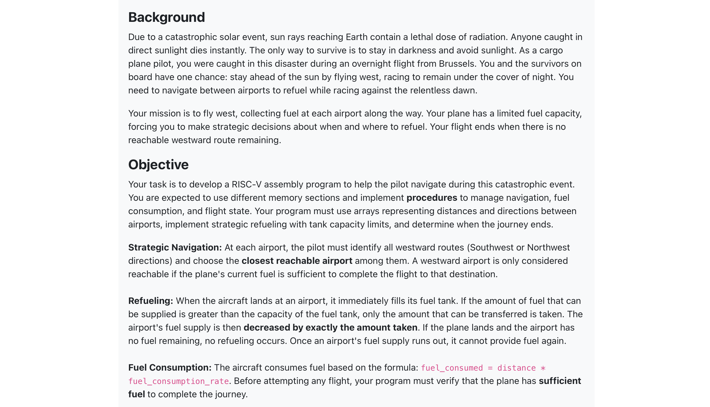
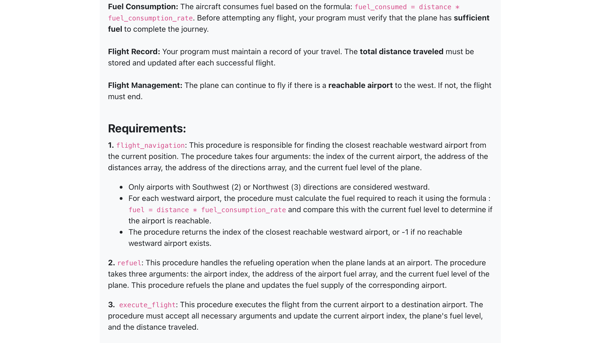
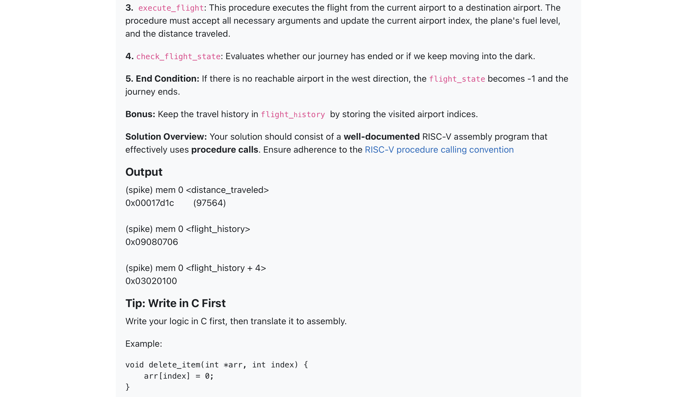
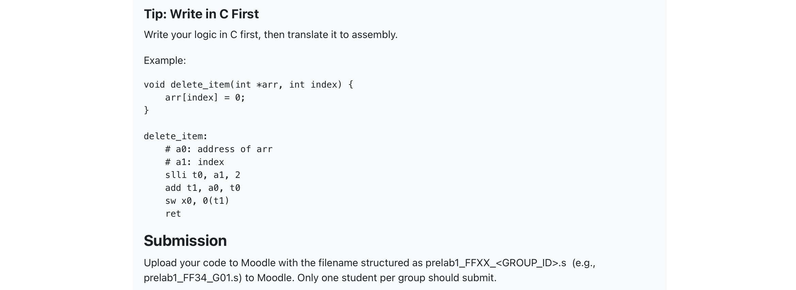

# Solar Escape: RISC-V Westward Flight Navigator

[](LICENSE)
[](#system-architecture)
[](#simulation-and-testing)
[](#overview)

A bare-metal **RISC-V (RV32I)** assembly simulation modeling fuel-constrained autonomous aircraft navigation under extreme planetary survival conditions. Built as part of the **CMPE 344 (Computer Organization)** curriculum at **Boğaziçi University**.

---

## Table of Contents
- [Overview](#overview)
- [Mission Scenario](#mission-scenario)
- [Key Features](#key-features)
- [System Architecture](#system-architecture)
  - [Memory Layout & Linker Mapping](#memory-layout--linker-mapping)
  - [Hardware Target & HTIF](#hardware-target--htif)
- [Subroutine Specifications](#subroutine-specifications)
- [Simulation Flow](#simulation-flow)
- [Project Structure](#project-structure)
- [Prerequisites & Environment](#prerequisites--environment)
- [Build and Run](#build-and-run)
- [Verification & Test Results](#verification--test-results)
- [License](#license)
- [Related Projects](#related-projects)

---

## Overview

**Solar Escape** is a bare-metal assembly program designed to solve a complex route selection and resource management problem directly on the RISC-V processor architecture without any operating system overhead. It adheres strictly to standard RISC-V procedure calling conventions (`calling conventions`), manual stack framing, and bare-metal memory sectioning (ROM/RAM division).

### Mission Scenario

> *Due to a catastrophic solar flare event, sunlight reaching Earth contains lethal radiation. The sole path to survival is to remain perpetually under the cover of night by flying relentlessly westward. Taking off from Brussels aboard an overnight cargo flight, your objective is to navigate from airport to airport across global waypoints, refueling within local tank and supply constraints, and surviving until no reachable westward route remains.*

<details>
<summary><b>Click to expand Mission Briefing & Specification Slides</b></summary>
<br>
<p align="center">
  
  
  <br><br>
  
  
</p>
</details>

---

## Key Features

- **Directional Vector Filtering**: Selects exclusively westward routes corresponding to Southwest (`2`) and Northwest (`3`) quadrant trajectories.
- **Dynamic Fuel Budgeting**: Implements a bounded fuel model (20,000 units capacity, 2 units/km consumption rate) that verifies fuel sufficiency before committing to flight legs.
- **Greedy Route Optimization**: Scans adjacent global airport nodes to dynamically select the closest reachable westward destination.
- **Airport Depot Depletion**: Simulates real-world refueling economics; aircraft consumes required fuel while simultaneously depleting local airport reserves.
- **Bare-Metal Memory Segregation**: Splits instructions and read-only distance matrices into ROM (`0x80000000`), while maintaining mutable flight telemetry, airport supplies, and stack memory in RAM (`0x80010000`).
- **Telemetry & Historical Audit Trail**: Records sequential airport visits and cumulative distance traveled in uninitialized `.bss` memory for post-simulation verification.

---

## System Architecture

### Memory Layout & Linker Mapping

The program is linked via a custom GNU Linker script (`linker.ld`) configured for a standard 32-bit RISC-V Harvard/Von-Neumann hybrid embedded memory model:

| Region | Address Range | Size | Section Types | Description |
| :--- | :--- | :--- | :--- | :--- |
| **ROM** | `0x80000000` - `0x8000FFFF` | 64 KB | `.text`, `.rodata` | Instructions, reset entry vector (`_start`), distance matrix, direction lookup table |
| **RAM** | `0x80010000` - `0x8001FFFF` | 64 KB | `.data`, `.bss`, `.stack` | Mutable airport reserves, flight telemetry, HTIF communication registers, stack pointer |

### Hardware Target & HTIF

The simulation targets the **Spike RISC-V ISA Simulator** utilizing Host-Target Interface (**HTIF**) control registers:
- `tohost` / `fromhost`: Memory-mapped communication channels in `.bss` used to signal simulator execution state and graceful termination via standard `ecall` system calls.

---

## Subroutine Specifications

All subroutines strictly adhere to the standard RISC-V Application Binary Interface (ABI):

| Subroutine | Arguments | Return Values | Description |
| :--- | :--- | :--- | :--- |
| `flight_navigation` | `a0`: Current airport index<br>`a1`: Pointer to distance matrix<br>`a2`: Pointer to direction matrix<br>`a3`: Current aircraft fuel | `a0`: Closest reachable airport index (`-1` if none) | Iterates across all candidate airports, filters for directions `2` (SW) and `3` (NW), computes required fuel (`dist * 2`), and returns the index of the closest reachable candidate. |
| `refuel` | `a0`: Airport index<br>`a1`: Pointer to `airport_supply`<br>`a2`: Current fuel level | `a0`: Updated fuel level | Calculates fuel required to top off tank (`20000 - current_fuel`), draws maximum available amount from airport stock, decreases depot supply, and returns new aircraft fuel level. |
| `execute_flight` | `a0`: Target airport index<br>`a1`: Pointer to `current_airport`<br>`a2`: Pointer to `current_fuel`<br>`a3`: Pointer to `distance_traveled`<br>`a4`: Pointer to distance matrix | *None* | Updates location pointer, subtracts consumed fuel, and accumulates incremental distance into global odometer. |
| `check_flight_state` | `a0`: Next airport index<br>`a1`: Pointer to `flight_state` | *None* | Assesses terminal state; if `next_airport == -1`, updates `flight_state` to `-1` to trigger simulation termination. |

---

## Simulation Flow

```
   [ Start @ Brussels (5) ]
              │
              ▼
    ┌───────────────────┐
    │  Refuel Aircraft  │ ◄─── Draw from local airport reserve
    └─────────┬─────────┘
              │
              ▼
    ┌───────────────────┐
    │ Flight Navigation │ ◄─── Find closest reachable SW (2) / NW (3) airport
    └─────────┬─────────┘
              │
      Reachable airport?
        /           \
     Yes             No (return -1)
      │               │
      ▼               ▼
┌──────────────┐  ┌───────────────────┐
│Execute Flight│  │ Set State = -1    │
└─────┬────────┘  └─────────┬─────────┘
      │                     │
      ▼                     ▼
┌──────────────┐     [ Terminate ]
│Record History│
└─────┬────────┘
      │
      └──────────► (Loop back to Refuel)
```

---

## Project Structure

```
Solar-Escape-RISCV-Navigator/
├── Makefile                       # Build, clean, and simulation orchestration
├── linker.ld                      # Custom RISC-V ROM/RAM memory map linker script
├── LICENSE                        # MIT License
├── README.md                      # Comprehensive project documentation
├── docs/
│   └── images/                    # Mission briefing and assignment specifications
│       ├── 1.png                  # Background and operational scenario
│       ├── 2.png                  # Mathematical formulas and fuel constraints
│       ├── 3.png                  # Procedure calling requirements & output targets
│       └── 4.png                  # Reference C architecture & submission notes
└── src/
    ├── flight_navigator.s         # Clean, thoroughly annotated RV32I assembly source
    └── prelab1_FF78_G17.s         # Original submission assembly artifact
```

---

## Prerequisites & Environment

### Option 1: Docker (Recommended)

Use the official Boğaziçi University CMPE 344 container environment which packages GCC RISC-V cross-compilers and Spike:

```bash
docker pull ghcr.io/bouncmpe/labs344
```

### Option 2: Native Toolchain

- **RISC-V GNU Toolchain**: `riscv64-unknown-elf-as`, `riscv64-unknown-elf-ld`
- **Spike RISC-V ISA Simulator**: `spike` (compiled with RV32 support)

---

## Build and Run

### 1. Build the Binary

```bash
make
```

This invokes `riscv64-unknown-elf-as` with `-march=rv32i -mabi=ilp32` and links using `linker.ld` to generate `build/flight_navigator.elf`.

### 2. Run Simulation via Spike

```bash
make run
```

Or run directly with memory window arguments:

```bash
spike -m0x80000000:0x20000 build/flight_navigator.elf
```

### 3. Run inside Docker

```bash
make docker-run
```

---

## Verification & Test Results

Upon simulation completion, memory telemetry can be verified via Spike interactive debugger (`spike -d`) or memory dump:

```bash
make debug
```

Inspect memory contents at the recorded symbols:

```text
(spike) mem 0 <distance_traveled>
0x00017d1c    (Decimal: 97564 km)

(spike) mem 0 <flight_history>
0x09080706

(spike) mem 0 <flight_history + 4>
0x03020100
```

### Route Sequence Breakdown

| Leg | Departure | Destination | Direction | Distance | Aircraft Fuel After Leg | Airport Remaining Fuel |
| :-: | :--- | :--- | :-: | :-: | :-: | :-: |
| **0** | *Initial* | Brussels (5) | — | — | 20,000 | 21,500 |
| **1** | Brussels (5) | Reykjavik (6) | NW (3) | 1,895 km | 16,210 | 15,500 |
| **2** | Reykjavik (6) | New York (7) | SW (2) | 4,163 km | 11,674 | 26,000 |
| **3** | New York (7) | Los Angeles (8) | SW (2) | 3,974 km | 12,052 | 27,000 |
| **4** | Los Angeles (8)| Honolulu (9) | SW (2) | 4,108 km | 11,784 | 40,000 |
| **5** | Honolulu (9) | Tokyo (0) | SW (2) | 6,136 km | 7,728 | 17,000 |
| **6** | Tokyo (0) | Hong Kong (1) | SW (2) | 2,962 km | 14,076 | 18,000 |
| **7** | Hong Kong (1) | Singapore (2) | SW (2) | 2,564 km | 14,872 | 16,000 |
| **8** | Singapore (2) | Dubai (3) | NW (3) | 5,845 km | 8,310 | 17,000 |
| **9** | Dubai (3) | *No Reachable West Route* | — | — | **Halt** | — |

- **Total Distance Traveled**: `97,564 km` (`0x17D1C`)
- **Recorded Path Array**: `[0x06, 0x07, 0x08, 0x09, 0x00, 0x01, 0x02, 0x03]`

---

## License

This project is licensed under the **MIT License**. See the [LICENSE](LICENSE) file for details.

---

## Related Projects

- **[CoreMark-Workload-Profiling](https://github.com/yigitsarpavci/CoreMark-Workload-Profiling)**: Comprehensive CPU benchmarking, compiler optimization analysis, and RISC-V architectural extensions.
- **[SchedSim-CPU-Scheduler](https://github.com/yigitsarpavci/SchedSim-CPU-Scheduler)**: Low-level CPU scheduling simulator written in x86-64 GNU Assembly.
- **[Aura-Functional-Interpreter](https://github.com/yigitsarpavci/Aura-Functional-Interpreter)**: Custom functional programming language interpreter with static/dynamic scoping.
- **[Nightpass-A-Survival-Card-Game](https://github.com/yigitsarpavci/Nightpass-A-Survival-Card-Game)**: Turn-based survival card game engine focusing on algorithmic fairness.

---

*Developed by Yiğit Sarp Avcı*
